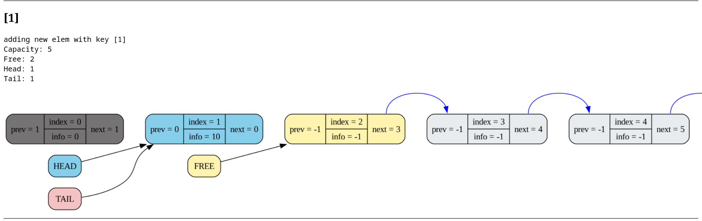
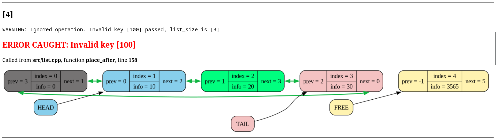
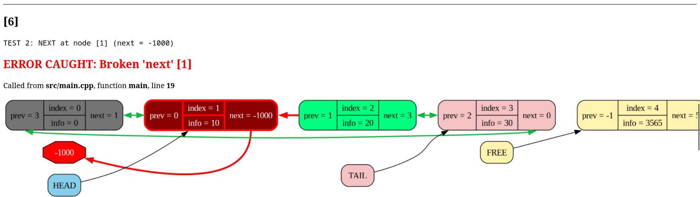
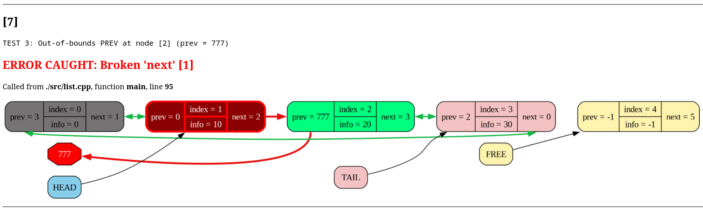
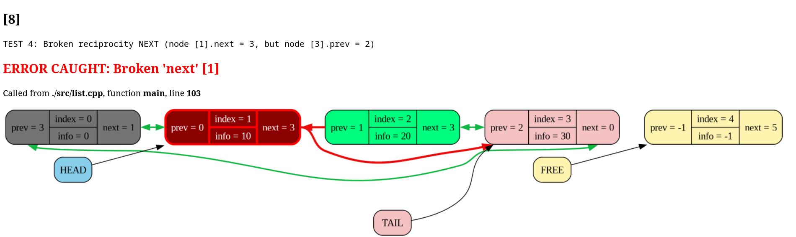
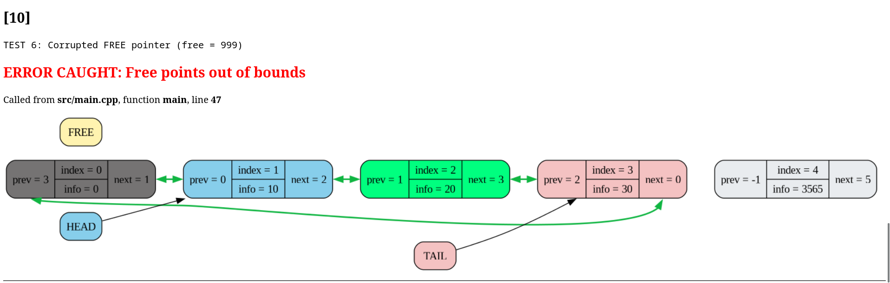
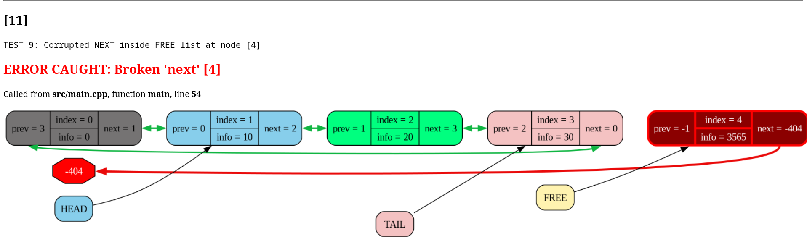

[](https://en.wikipedia.org/wiki/C_(programming_language))

[](https://github.com/NikolayNetreba/Task5/network/members)
[](https://github.com/NikolayNetreba/Task5/stargazers)
[](https://github.com/NikolayNetreba/Task5/pulls)
[](https://github.com/NikolayNetreba/Task5/commits/main)

# Двусвязный список



# Постановка задачи:
- :white_check_mark: Реализовать двусвязный список
- :white_check_mark: Сделать валидацию ошибок
- :white_check_mark: Сделать визуальный дамп, используя graphviz

# Общая архитектура
```linked list
.
├── dumps
|
├── include
|   └── list.h
|
├── obj
|
├── src
|   ├── dump.cpp
|   ├── list.cpp
|   └── main.cpp
|
└── dump.html
```
```dumps``` - туда сохраняются сгенерированые графы (визуализация листа)

# Компиляция и запуск
- Можно скомпилировать используя makefile - make.
- И запустить -./list
- Чтобы выключить отладочный режим нужно убрать ```define DEBUG``` из файла ```list.h```.

# Фичи
- **dump с визуализацие списка** Полная распечатка списка на каждой итерации, подсветка ошибок.

# Пример ошибок
<details>
<summary>Пользователь ввел аргумент выходящй за границы списка</summary>


</details>

<details>
<summary>Сломанный next вышел за границы</summary>


</details>

<details>
<summary>Сломанный prev вышел за границы</summary>


</details>

<details>
<summary>Сломанный next</summary>


</details>

<details>
<summary>free вышел за границы</summary>


</details>

<details>
<summary>Сломанный свободный элемент</summary>


</details>

# Благодарности
Большое спасибо [Тимофею Сидорову](https://github.com/2210223t-lang) за помощь в тестировании при разработки этого проекта

Большое спасибо [Деду](https://wiki.mipt.tech/index.php/%D0%94%D0%B5%D0%B4%D0%B8%D0%BD%D1%81%D0%BA%D0%B8%D0%B9_%D0%98%D0%BB%D1%8C%D1%8F_%D0%A0%D1%83%D0%B4%D0%BE%D0%BB%D1%8C%D1%84%D0%BE%D0%B2%D0%B8%D1%87) - За победу.
